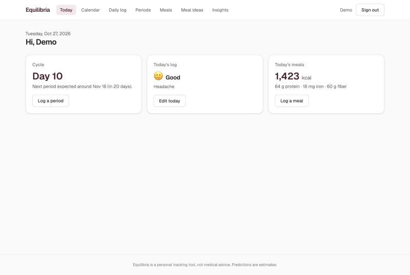
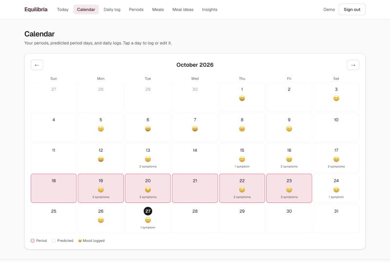
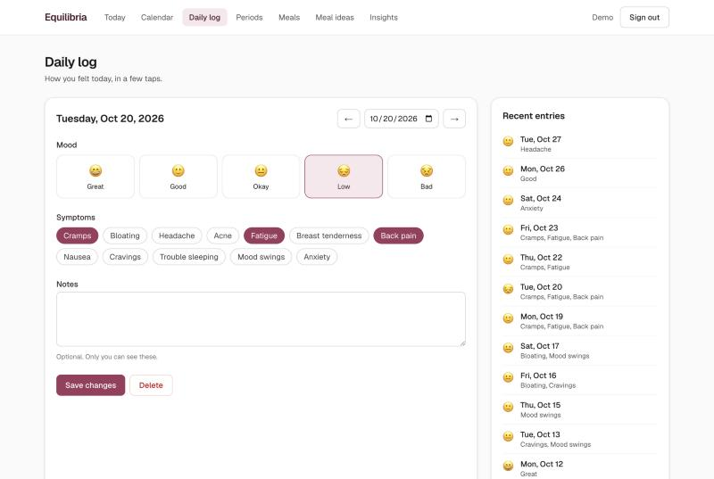
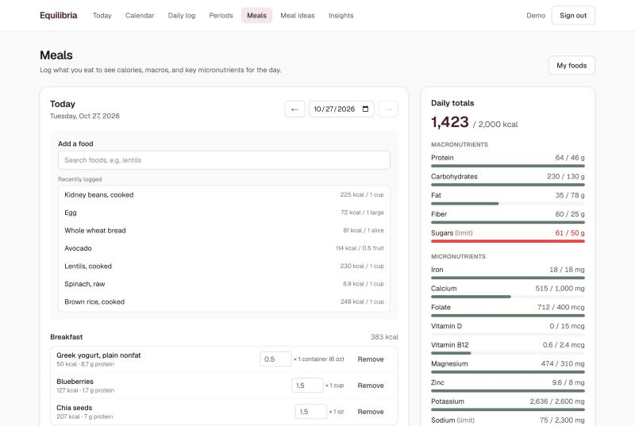
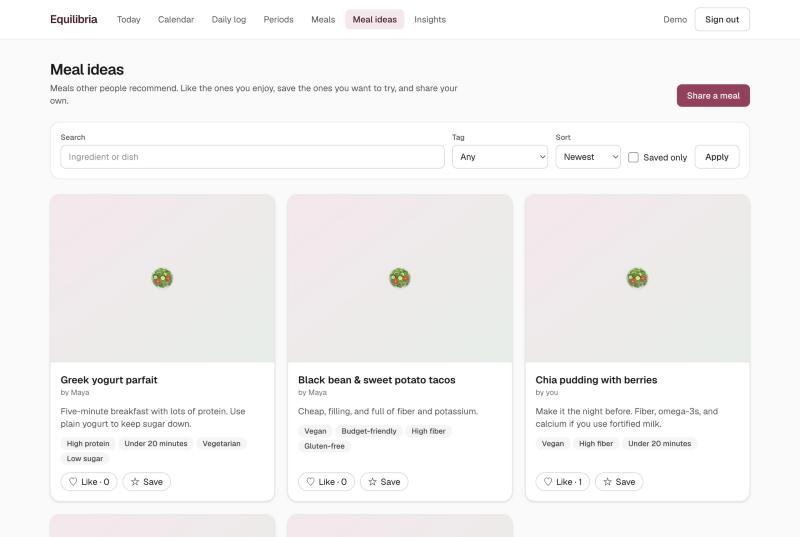
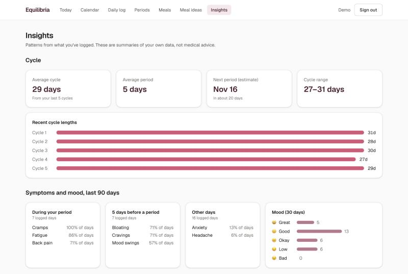
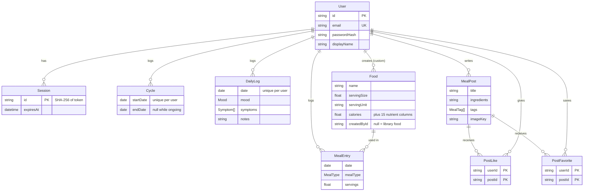

# Equilibria

[](https://github.com/blaisescileppi/Equilibria/actions/workflows/ci.yml)

A full-stack women's health tracker. Log your periods, daily mood and symptoms, and meals, then see your cycle averages, a next-period estimate, nutrient totals, and symptom patterns. A community board lets people share, like, and save meal ideas.

Built with **Next.js 16 (App Router)**, **React 19**, **TypeScript**, **Tailwind CSS 4**, **Prisma 7**, and **PostgreSQL**.

> Equilibria is a personal tracking tool, not medical advice. Predictions are estimates based only on what you log.

## Features

- **Accounts.** Email and password sign-up with bcrypt password hashing and database-backed sessions in `HttpOnly` cookies.
- **Cycle tracking.** Create, edit, and delete periods. The app rejects overlapping periods and allows only one ongoing period.
- **Daily log.** Mood, symptoms, and private notes, one entry per day, with full create, edit, and delete.
- **Calendar.** A month view of period days, predicted period days, and logged moods. Each past day links to its log.
- **Meal tracking.** Search 99 common foods from USDA FoodData Central, or add your own. Daily totals cover calories, 5 macronutrients, and 10 micronutrients (iron, calcium, folate, vitamin D, B12, magnesium, zinc, potassium, sodium, vitamin C), compared with NIH and FDA reference values.
- **Meal ideas board.** Post meals with ingredients, instructions, tags, and an optional photo. Browse with search, tag filters, and "most liked" sorting. Like and save posts.
- **Insights.** Average cycle and period length, next-period estimate, cycle variability, the most common symptoms during and before periods, mood distribution, and 7-day average nutrition.
- **Validation everywhere.** One set of [zod](https://zod.dev) schemas validates every request body and query string on the server. The forms reuse them for instant feedback.

## Screenshots

| Today | Calendar |
| --- | --- |
|  |  |
| **Daily log** | **Meals** |
|  |  |
| **Meal ideas** | **Insights** |
|  |  |

## Tech stack

| Layer | Choice | Why |
| --- | --- | --- |
| Framework | Next.js 16, App Router | Server Components fetch data on the server, and Route Handlers serve the JSON API, in one TypeScript codebase. |
| Language | TypeScript (strict) | Database types generated by Prisma flow through services, API responses, and components. |
| Styling | Tailwind CSS 4 | Design tokens such as `brand` and `period` are defined once in `globals.css`. |
| Database | PostgreSQL 17 | Relational data with real constraints: unique indexes, foreign keys, enum and array columns. |
| ORM | Prisma 7, `@prisma/adapter-pg` | Type-safe queries, versioned SQL migrations, and transactions. |
| Validation | zod 4 | One schema per input, shared by the browser and the server. |
| Tests | Vitest 5 | Fast unit tests for pure logic, plus integration tests that call the real route handlers against a test database. |
| CI | GitHub Actions | Lint, type check, tests against a Postgres service container, and a production build on every push. |

## Getting started

### Prerequisites

- Node.js 22 or newer (developed on Node 24)
- PostgreSQL 15 or newer. On macOS: `brew install postgresql@17 && brew services start postgresql@17`

### Setup

```bash
git clone https://github.com/blaisescileppi/Equilibria.git
cd Equilibria
npm install                      # also generates the Prisma client

createdb equilibria_dev          # the app's database
createdb equilibria_test         # a separate database the tests may wipe

cp .env.example .env             # then edit the two URLs in .env
npm run db:migrate               # apply migrations to equilibria_dev
npm run db:seed                  # food library + demo account
npm run dev
```

Open http://localhost:3000 and sign in with the demo account created by the seed script:

- **Email:** `demo@equilibria.test`
- **Password:** `equilibria-demo`

The demo data is dated relative to today, so the calendar and predictions always look current. Running `npm run db:seed` again resets the demo account.

### Environment variables

| Variable | Purpose |
| --- | --- |
| `DATABASE_URL` | Postgres connection string the app uses. |
| `TEST_DATABASE_URL` | Database for the integration tests. Its name must contain `test`, because the tests delete every row in it. |
| `UPLOAD_DIR` | Optional. Where uploaded meal photos are stored. Defaults to `./uploads`. |

`.env` is git-ignored. Only `.env.example` is committed.

### Scripts

| Command | What it does |
| --- | --- |
| `npm run dev` | Start the dev server. |
| `npm run build` / `npm start` | Production build and server. |
| `npm run lint` | ESLint with the Next.js and TypeScript rules. |
| `npm run typecheck` | Generate route types, then run `tsc --noEmit`. |
| `npm test` | Unit and integration tests. |
| `npm run test:watch` | Re-run tests on file changes. |
| `npm run db:migrate` | Create or apply migrations in development. |
| `npm run db:seed` | Load the food library and demo data. |
| `npm run db:reset` | Drop, re-migrate, and re-seed the dev database. |

## Architecture

```
src/
  app/                 Pages (Server Components) and api/ Route Handlers
  components/          UI: shared primitives plus feature folders (cycles, logs, meals, board)
  lib/                 Pure, framework-free code: dates, cycle math, nutrition, validation
  server/
    auth/              Password hashing, sessions, current-user lookup
    services/          Prisma queries, always scoped to the signed-in user
    http.ts            Route wrapper: origin check, input parsing, uniform JSON errors
    storage.ts         Image storage (local disk behind a small interface)
  proxy.ts             Early redirect for signed-out visitors (Next 16's "middleware")
prisma/
  schema.prisma        Data model
  migrations/          Versioned SQL, applied by `prisma migrate`
  seed.ts              Food library and demo data
  data/foods.json      Food library generated from USDA data
scripts/               Rebuilds foods.json from the USDA download
test/integration/      API tests against a real Postgres database
```

**How a request flows.** A page is a Server Component. It renders its static parts immediately, and inside a `<Suspense>` boundary it calls `requireUser()` and a service function to load that user's data. Forms are Client Components that send JSON (or multipart, for photos) to `/api/...`. Each route handler authenticates the session cookie, validates the input with a zod schema, and calls a service. The client then runs `router.refresh()` to re-render the server parts with fresh data.

**Why the layers are split.** Route handlers only deal with HTTP. Services own the database rules, and every query filters by `userId`. Logic such as "predict the next period" or "total these nutrients" lives in `src/lib` as pure functions, so it's unit-tested without a database.

### API

All endpoints return JSON and require a session cookie, except signup and login. Errors share one shape: `{ "error": "message", "fields": { "fieldName": "message" } }`.

| Method | Path | Purpose |
| --- | --- | --- |
| POST | `/api/auth/signup`, `/api/auth/login`, `/api/auth/logout` | Account and session management. |
| GET, POST | `/api/cycles` | List periods with insights; log a period. |
| PUT, DELETE | `/api/cycles/:id` | Edit or delete a period. |
| GET, POST | `/api/logs?month=YYYY-MM` | List a month's daily logs; create a log. |
| PUT, DELETE | `/api/logs/:id` | Edit or delete a log. |
| GET, POST | `/api/foods?q=` | Search the library plus your foods; create a custom food. |
| DELETE | `/api/foods/:id` | Delete a custom food that isn't used by any logged meal. |
| GET, POST | `/api/meals?date=YYYY-MM-DD` | A day's entries and nutrient totals; log a food. |
| PUT, DELETE | `/api/meals/:id` | Edit servings or meal type; remove an entry. |
| GET, POST | `/api/posts?q=&tag=&sort=new\|popular&saved=1` | Browse posts; create one (multipart, optional `image`). |
| GET, PUT, DELETE | `/api/posts/:id` | Read, edit (author only), or delete (author only) a post. |
| PUT, DELETE | `/api/posts/:id/like`, `/api/posts/:id/favorite` | Like or save, and undo. Safe to repeat. |
| GET | `/api/uploads/:key` | Serve an uploaded photo. |

## Schema overview



Design notes:

- **Dates are `DATE` columns**, not timestamps, and the app handles them as `YYYY-MM-DD` strings with UTC-only math, so time zones can't shift a log to the wrong day. The browser reports its time zone in a cookie, so the server knows the user's "today".
- **Constraints live in the database.** These hold even if application code has a bug:
  - one daily log per user per day: `@@unique([userId, date])`
  - one like per user per post: a composite primary key
  - no deleting a food that logged meals use: a foreign key with `NO ACTION`
- **Nutrients are typed columns**, not a JSON blob, so they're validated, typed by Prisma, and can be queried.
- **Cycle length isn't stored.** It's derived from consecutive start dates, so it can't fall out of sync.
- **Deleting a user cascades** to all of their data. A test covers this.

## Testing

```bash
npm test
```

- **Unit tests** (`src/**/*.test.ts`) cover date math (including daylight-saving and leap-year edges), cycle insights, nutrient totals, validation rules, image type detection, and symptom summaries.
- **Integration tests** (`test/integration/`) import the real route handlers, call them with real `Request` objects, and check both the HTTP responses and the database. Before the run, `test/global-setup.ts` applies migrations to `TEST_DATABASE_URL`. Each test starts from empty tables. They cover:
  - authorization: other users' records return 404
  - validation errors
  - overlap and duplicate rules
  - idempotent likes
  - image upload checks, and cleanup when photos are replaced or deleted
  - cross-site request blocking

CI runs the same suite against a Postgres 17 service container. See [`.github/workflows/ci.yml`](.github/workflows/ci.yml).

## Security and data integrity

- Passwords are hashed with bcrypt (cost 12). Inputs over 72 bytes are rejected rather than silently truncated.
- Session tokens are 32 random bytes. Only their SHA-256 hash is stored. Cookies are `HttpOnly`, `SameSite=Lax`, and `Secure` in production.
- Logout deletes the session row, so a copied cookie stops working.
- Login gives the same error, in about the same time, for an unknown email and for a wrong password.
- Mutating requests with a foreign `Origin` header are rejected (403).
- Every service query is scoped to the signed-in user. Another user's record looks like it doesn't exist.
- Period writes run in serializable transactions, so concurrent requests can't create overlapping periods.
- Uploads are identified by their first bytes (JPEG, PNG, or WebP only), capped at 2 MB, and stored under random UUIDs. The image route refuses any key it didn't generate, which blocks path traversal.
- After login, the app only redirects to same-site paths.

## Known limitations and next steps

- **Education tab** (planned): articles and interviews with board-certified physicians about women's health conditions.
- **Photo storage** is the local disk. Deploying to a serverless host needs object storage (for example S3 or Vercel Blob). Only `src/server/storage.ts` would change.
- No password reset, email verification, or login rate limiting yet.
- The food library has 99 foods. USDA left 11 values unmeasured; they're recorded as 0 and listed in `prisma/data/foods.json`.
- `node-postgres` prints a deprecation warning during some Prisma transactions. It comes from inside `@prisma/adapter-pg` and doesn't affect results.

## Data sources

Food nutrient values come from the U.S. Department of Agriculture, Agricultural Research Service, **FoodData Central: SR Legacy** (April 2018), which is in the public domain. `scripts/build-food-library.ts` regenerates `prisma/data/foods.json` from the [CSV download](https://fdc.nal.usda.gov/download-datasets). Reference intakes follow the NIH Office of Dietary Supplements and the FDA Daily Values for non-pregnant women aged 19 to 50.

## Rebuilding this project

[`docs/BUILD_GUIDE.md`](docs/BUILD_GUIDE.md) walks through how the app was built, step by step, with the reasoning behind each decision.
